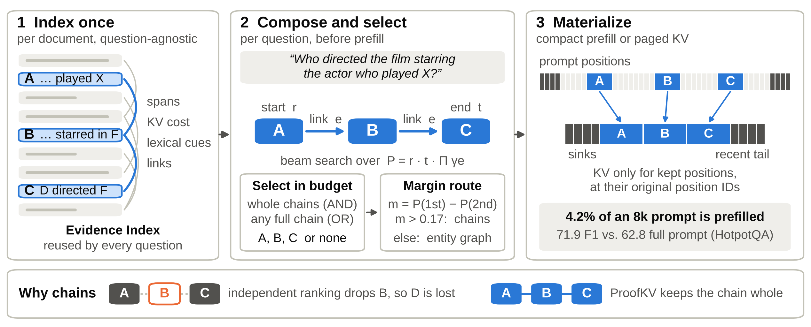

# ProofKV

Code, records, and scorer checkpoints for

> **ProofKV: Compiling Complete Evidence Chains into Reusable KV Memory for Structured-Evidence QA**
> Xingjian Zhang. *Findings of EACL 2027.*

KV-cache eviction and prompt compression score tokens, chunks, or heads one at a time. A multi-hop question needs
every link of an evidence chain, and a link is worth little unless the rest of the chain survives with it. ProofKV
reads a document once into a reusable evidence index, composes question-specific evidence chains with a small
learned scorer, and prefills the decoder only over the chains that fit a KV-byte budget.



## Results at a glance

| Setting | Result |
|---|---|
| Held-out MuSiQue test (500 questions, 512 tokens): questions that keep a complete gold chain | **46.0%**, vs. 27.0% for the same scorer ranking spans independently |
| Five tasks, two decoders, exact 128/256/512-token caps | best compact method in every cell; **+13.32 F1** over same-scorer independent ranking, **+19.33 F1** over LLMLingua-2 at identical token counts |
| Qwen2.5-14B, no change to scorer or thresholds | +15.55 F1 and +20.86 F1 on the same two comparisons |
| One link removed from the selected chain at equal bytes | 10.6 to 15.6 F1 lost on MuSiQue, HotpotQA, and 2WikiMultiHopQA |
| HotpotQA packed to 8k/16k/32k tokens | 71.9 / 73.3 / 69.3 F1 with 4.2 / 2.1 / 1.1% of the prompt, vs. 62.8 / 57.8 / 53.1 for the full prompt |
| End-to-end serving on one H100 with a reused index | 1.16 to 1.84x faster than full context |

## Repository layout

| Path | Contents |
|---|---|
| `proofkv/` | The package: evidence index, scorer, chain search, AND/OR selection, routing, compact prefill and paged KV |
| `scripts/` | Training, evaluation, baseline, intervention, serving, and audit entry points used for the paper, indexed in [`scripts/README.md`](scripts/README.md) |
| `experiments/followup/` | Code of the follow-up analyses (compressor comparison, link removal across datasets, iterative retrieval, gap decomposition, related distractors) |
| `analysis/` | Scripts that recompute the statistics and regenerate every table and figure from the records |
| `results/paper/` | Results of the original evaluation: the canonical result file and the records it was built from, with per-example predictions |
| `results/followup/` | Per-example records of the follow-up analyses and their summary |
| `paper/` | The camera-ready PDF and the tables and figures generated for it |
| `configs/`, `protocols/` | Experiment configurations and the protocols fixed before held-out runs |
| `models/public_models.json` | Exact revisions and digests of the public decoders and compressors |
| `third_party/` | Pinned baseline code (KVPress, RULER) and compatibility patches, under their own licenses |
| `checkpoints/` | Where the scorer checkpoints go (downloaded from the release page) |
| `docs/` | Data sources and question slices, the table-by-table reproduction guide, the model card, and licenses |
| `tests/` | Unit tests |

## Installation

The main environment is Python 3.12 with PyTorch 2.8 and Transformers 5.12 (`requirements-formal.txt`). Install a
PyTorch build that matches your CUDA version first, then:

```bash
python -m venv .venv && source .venv/bin/activate
pip install -r requirements-formal.txt
pip install -e .
python -m pytest -q
```

## Checkpoints

Download the scorer checkpoints from the [release page](https://github.com/XingjianZhang-dev/ProofKV/releases) and
unpack them into `checkpoints/`. [`checkpoints/README.md`](checkpoints/README.md) lists their SHA-256 digests and says
which results each one produced. Both are MiniLM-L12-H384 cross-encoders (about 133 MB) with start, end, and link heads.

## Reproducing the numbers without a GPU

The records behind every table and figure are in `results/`, so the paper's numbers can be checked on a laptop:

```bash
python analysis/verify_release.py
```

recomputes the follow-up statistics from the per-example records, regenerates all 51 generated tables, and compares
them byte for byte with `paper/tables/`. The individual steps:

```bash
python analysis/followup_statistics.py results/followup results/followup/summary.json
python analysis/make_followup_tables.py results/followup/summary.json paper/tables results/paper/canonical_results.json
python analysis/make_paper_tables.py --out paper/tables
python analysis/make_figures.py --paper results/paper/canonical_results.json \
    --routing results/paper/routing_summary.json --followup results/followup/summary.json --out paper/figures
```

[`docs/REPRODUCE.md`](docs/REPRODUCE.md) maps every table and figure of the paper to its file, script, and records.

## Running ProofKV

Datasets are public and are not redistributed here: HotpotQA from the Hugging Face hub, and the HotpotQA,
2WikiMultiHopQA, and MuSiQue subsamples from the IRCoT processed data. [`docs/DATA.md`](docs/DATA.md) describes the files
and the question slices used by each experiment.

Held-out selector test (500 MuSiQue questions; selector only, the decoder's tokenizer is used for budgets):

```bash
python experiments/followup/heldout_selector/oracle_gap.py --split test \
    --data-file $IRCOT/musique/test_subsampled.jsonl \
    --official-dev $MUSIQUE/musique_ans_v1.0_dev.jsonl \
    --scorer-checkpoint checkpoints/proofkv_scorer_musique_replay_v6 \
    --model Qwen/Qwen2.5-7B-Instruct --max-samples 1000 --budgets 256,512 \
    --out-dir runs/heldout_selector
```

Fixed-budget generation with the final checkpoint:

```bash
python scripts/run_hotpot_compact_qa.py --dataset hotpotqa --split validation \
    --model Qwen/Qwen2.5-7B-Instruct --scorer-checkpoint checkpoints/proofkv_scorer_final \
    --max-samples 128 --sample-offset 0 --seed 17 --budget-tokens 512 --max-new-tokens 24 \
    --attn-implementation sdpa \
    --learned-dense-core-count 4 --learned-edge-batch-size 256 \
    --methods full,entity_graph_adaptive,learned_root_topk,learned_topk_paths,oracle_adaptive \
    --out-dir runs/hotpot_fixed512
```

[`docs/REPRODUCE.md`](docs/REPRODUCE.md) lists the entry point of every experiment and the names that code and
records use for the methods of the paper; [`experiments/followup/README.md`](experiments/followup/README.md) gives
the commands of the follow-up analyses.

## Citation

```bibtex
@inproceedings{zhang-2027-proofkv,
  title     = {{ProofKV}: Compiling Complete Evidence Chains into Reusable {KV} Memory for Structured-Evidence {QA}},
  author    = {Zhang, Xingjian},
  booktitle = {Findings of the Association for Computational Linguistics: EACL 2027},
  year      = {2027},
  address   = {Athens, Greece},
  publisher = {Association for Computational Linguistics}
}
```

## License

The ProofKV code and the released checkpoints are under the MIT License (`LICENSE`). Code under `third_party/` keeps
its upstream license, and datasets and public models keep theirs; see `docs/ARTIFACT_LICENSES.md` and
`docs/THIRD_PARTY.md`.
